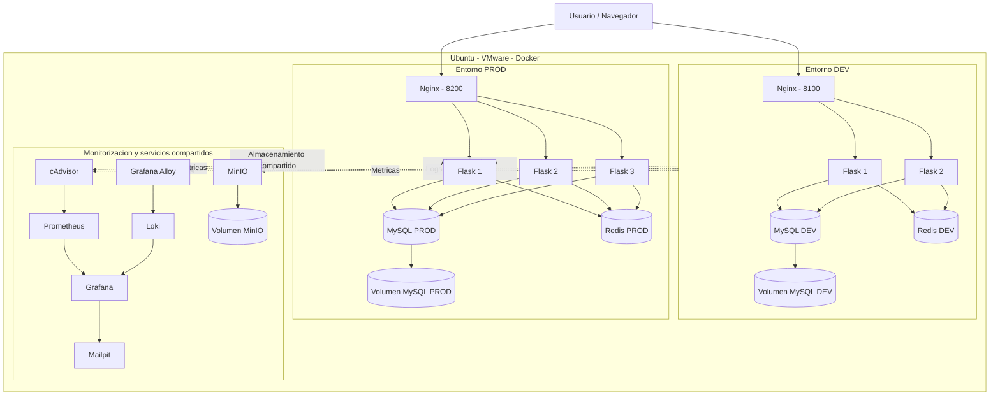
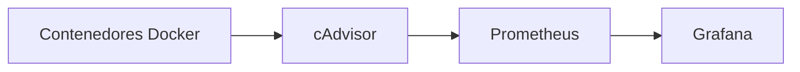
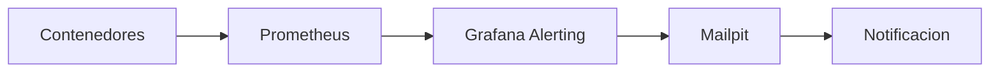
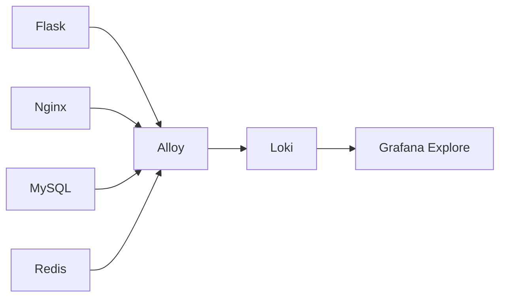

# Práctica 2 - Infraestructura como Código con Terraform

Redes Avanzadas - Universidad de las Illes Balears (UIB)

## 1. Objetivos

El objetivo de esta práctica es adaptar la aplicación de Inazuma Eleven desarrollada en la Práctica 1 a una infraestructura automatizada mediante Terraform y Docker, simulando un despliegue en el cloud.

La infraestructura permite:

- Desplegar simultáneamente los entornos DEV y PROD.
- Automatizar la creación de recursos mediante Terraform.
- Reutilizar configuraciones mediante módulos.
- Distribuir las peticiones mediante un balanceador de carga.
- Escalar horizontalmente la aplicación web.
- Garantizar la persistencia de los datos.
- Mejorar el rendimiento mediante Redis.
- Monitorizar el estado, CPU y memoria de los contenedores.
- Centralizar los logs de los servicios.
- Detectar incidencias mediante alertas.
- Utilizar almacenamiento compartido compatible con S3.
- Automatizar el despliegue y las pruebas mediante Makefile.

Toda la infraestructura se ejecuta sobre Ubuntu en una máquina virtual VMware, utilizando Docker sin Docker Swarm.

## 2. Arquitectura

La infraestructura se divide en tres entornos Terraform independientes: desarrollo, producción y monitorización.



Cada entorno dispone de sus propios contenedores, redes, base de datos y caché.

Las réplicas Flask de un mismo entorno comparten MySQL y Redis, mientras que los servicios de monitorización y almacenamiento se gestionan desde un entorno independiente.

El diagrama representa las relaciones funcionales entre los servicios.

## 3. Tecnologías utilizadas

| Tecnología | Funcionalidad |
|---|---|
| Terraform | Gestión declarativa de infraestructura |
| HCL | Lenguaje de configuración de Terraform |
| Docker | Ejecución de contenedores |
| Flask | Aplicación web |
| Python | Desarrollo de la aplicación y automatización |
| MySQL | Base de datos relacional |
| Redis | Sistema de caché |
| Nginx | Balanceador de carga |
| cAdvisor | Recopilación de métricas de contenedores |
| Prometheus | Almacenamiento y consulta de métricas |
| Grafana | Visualización y alertas |
| Loki | Centralización de logs |
| Grafana Alloy | Recopilación de logs |
| Mailpit | Recepción de notificaciones |
| MinIO | Almacenamiento compatible con S3 |
| Makefile | Automatización de comandos |
| Bash | Scripts de inicialización y pruebas |
| Git | Control de versiones |
| GitHub | Repositorio público |
| VMware | Virtualización |
| Ubuntu | Sistema operativo de despliegue |

Se utiliza el proveedor Docker de Terraform `kreuzwerker/docker`, versión 4.6.0.

No se utiliza Docker Swarm. La creación de las réplicas, redes, imágenes, contenedores y volúmenes se gestiona mediante Terraform.

## 4. Entornos de despliegue

### Entorno DEV

El entorno de desarrollo dispone de:

- Dos réplicas Flask.
- Un balanceador Nginx.
- Una base de datos MySQL.
- Un servicio Redis.
- Redes independientes.
- Monitorización activa.

Acceso:

http://localhost:8100

### Entorno PROD

El entorno de producción dispone de:

- Tres réplicas Flask.
- Un balanceador Nginx.
- Una base de datos MySQL.
- Un servicio Redis.
- Redes independientes.
- Monitorización activa.
- Alertas de funcionamiento.
- Alta disponibilidad de las réplicas web.

Acceso:

http://localhost:8200

### Comparativa de entornos

| Característica | DEV | PROD |
|---|---|---|
| Réplicas Flask | 2 | 3 |
| Puerto web | 8100 | 8200 |
| MySQL | Sí | Sí |
| Redis | Sí | Sí |
| Nginx | Sí | Sí |
| Monitorización | Sí | Sí |
| Alertas | Sí | Sí |
| Persistencia | Sí | Sí |
| Tolerancia a fallos de réplicas | Sí | Sí |

Ambos entornos pueden funcionar simultáneamente.

La configuración específica se establece mediante los archivos `terraform.tfvars`.

## 5. Estructura del proyecto

```text
Practica2/
├── app/
│   ├── .gitkeep
│   ├── Dockerfile
│   ├── app.py
│   ├── requirements.txt
│   ├── static/
│   │   └── images/
│   └── templates/
│       └── index.html
│
├── db/
│   ├── Dockerfile
│   └── init.sql
│
├── environments/
│   ├── dev/
│   │   ├── .terraform.lock.hcl
│   │   ├── main.tf
│   │   ├── outputs.tf
│   │   ├── terraform.tfvars
│   │   ├── variables.tf
│   │   └── versions.tf
│   │
│   ├── prod/
│   │   ├── .terraform.lock.hcl
│   │   ├── main.tf
│   │   ├── outputs.tf
│   │   ├── terraform.tfvars
│   │   ├── variables.tf
│   │   └── versions.tf
│   │
│   └── monitoring/
│       ├── .terraform.lock.hcl
│       ├── config.alloy
│       ├── logs.tf
│       ├── loki.yml
│       ├── mailpit.tf
│       ├── main.tf
│       ├── minio.tf
│       ├── prometheus.yml
│       └── grafana/
│           ├── alert-rules.json
│           ├── contact-points.json
│           ├── datasources.json
│           ├── folders.json
│           ├── notification-policies.json
│           └── dashboards/
│               ├── ad5cl66.json
│               ├── add5226.json
│               ├── adk6hsf.json
│               └── adzgrpx.json
│
├── modules/
│   ├── cache/
│   │   ├── main.tf
│   │   ├── outputs.tf
│   │   └── variables.tf
│   │
│   ├── database/
│   │   ├── main.tf
│   │   ├── outputs.tf
│   │   └── variables.tf
│   │
│   ├── loadbalancer/
│   │   ├── main.tf
│   │   ├── nginx.conf.tftpl
│   │   ├── outputs.tf
│   │   └── variables.tf
│   │
│   ├── monitoring/
│   │   └── main.tf
│   │
│   ├── network/
│   │   ├── main.tf
│   │   ├── outputs.tf
│   │   └── variables.tf
│   │
│   └── web/
│       ├── main.tf
│       ├── outputs.tf
│       └── variables.tf
│
├── scripts/
│   ├── minio-demo/
│   │   └── prueba.txt
│   ├── demo-alertas.sh
│   ├── demo.sh
│   ├── export-grafana.py
│   ├── init-minio.sh
│   ├── restore-grafana.py
│   ├── test-cache.sh
│   ├── test-logs.sh
│   ├── test-minio.sh
│   ├── test-monitoring.sh
│   └── test-persistencia.sh
│
├── .gitignore
├── Makefile
└── README.md
```

Las imágenes de los jugadores se muestran agrupadas para facilitar la lectura.

### Módulos reutilizables

| Módulo | Responsabilidad |
|---|---|
| network | Creación de redes Docker |
| database | MySQL, credenciales y persistencia |
| cache | Creación del servicio Redis |
| web | Construcción de imágenes y réplicas Flask |
| loadbalancer | Configuración de Nginx |
| monitoring | Recopilación de métricas mediante cAdvisor |

La utilización de módulos permite evitar duplicidades, facilitar el mantenimiento y reutilizar los mismos componentes en DEV y PROD.

### Organización de Terraform

| Archivo | Función |
|---|---|
| main.tf | Definición de recursos y módulos |
| variables.tf | Declaración de variables |
| outputs.tf | Valores de salida |
| versions.tf | Versiones y proveedores |
| terraform.tfvars | Configuración específica del entorno |
| .terraform.lock.hcl | Versiones seleccionadas de los proveedores |

Los estados de Terraform se mantienen de forma independiente para cada entorno.

Los archivos de estado y los directorios internos de Terraform no se publican en GitHub.

## 6. Requisitos previos

Para ejecutar el proyecto es necesario disponer de:

- Ubuntu.
- Docker Engine.
- Terraform.
- Git.
- Make.
- Bash.
- Python 3.
- curl.
- Conexión a Internet para descargar imágenes y proveedores.

Comprobación de herramientas:

```bash
docker version
terraform version
git --version
make --version
python3 --version
curl --version
```

Durante el desarrollo se ha utilizado Windows con Visual Studio Code para editar los archivos y Ubuntu sobre VMware para ejecutar la infraestructura.

VMware no es un requisito obligatorio si se dispone de un sistema Linux compatible con Docker y Terraform.

## 7. Instalación y despliegue

### 7.1. Preparación

Clonar el repositorio y acceder al directorio de la Práctica 2.

Consultar los comandos disponibles:

```bash
make help
```

Formatear los archivos Terraform:

```bash
make fmt
```

### 7.2. Inicialización

```bash
make init-dev
make init-prod

terraform -chdir=environments/monitoring init
```

### 7.3. Validación

```bash
make validate-dev
make validate-prod

terraform -chdir=environments/monitoring validate
```

### 7.4. Planificación

```bash
make plan-dev
make plan-prod
make plan-monitoring
```

Los planes permiten comprobar los recursos que Terraform pretende crear, modificar o eliminar antes de aplicar los cambios.

### 7.5. Despliegue completo

```bash
make deploy-full
```

Se deben revisar los cambios propuestos antes de aceptar las confirmaciones de Terraform.

### 7.6. Restauración de Grafana

```bash
make restore-grafana
```

Este comando restaura la configuración exportada de Grafana, incluyendo las fuentes de datos, dashboards y alertas disponibles.

### 7.7. Comprobación

```bash
make check
make check-full
make test-monitoring
make test-logs
```

La comprobación de un despliegue independiente desde un repositorio limpio queda reservada para el simulacro final.

## 8. Acceso a los servicios

| Servicio | Dirección |
|---|---|
| Aplicación DEV | http://localhost:8100 |
| Estado DEV | http://localhost:8100/status |
| Aplicación PROD | http://localhost:8200 |
| Estado PROD | http://localhost:8200/status |
| Prometheus | http://localhost:8400 |
| Grafana | http://localhost:8500 |
| Loki | http://localhost:8600 |
| Alloy | http://localhost:8700 |
| Mailpit | http://localhost:8025 |

Los puertos y la configuración de MinIO se encuentran definidos en `environments/monitoring/minio.tf`.

Las credenciales administrativas no se incluyen en la documentación pública.

## 9. Balanceo de carga y alta disponibilidad

Se utiliza Nginx como balanceador de carga para distribuir las peticiones entre las diferentes instancias Flask.

La política seleccionada es Round Robin.

Round Robin distribuye las peticiones entre las instancias disponibles de forma rotatoria.

### Justificación

- Configuración sencilla.
- Distribución equilibrada de peticiones.
- Adecuado para réplicas con características similares.
- Facilita la escalabilidad horizontal.
- Permite demostrar el funcionamiento del balanceador.
- No requiere mecanismos adicionales de orquestación.

### Entorno DEV

```text
Petición 1 → Flask DEV 1
Petición 2 → Flask DEV 2
Petición 3 → Flask DEV 1
Petición 4 → Flask DEV 2
```

### Entorno PROD

```text
Petición 1 → Flask PROD 1
Petición 2 → Flask PROD 2
Petición 3 → Flask PROD 3
Petición 4 → Flask PROD 1
```

Estos ejemplos representan el comportamiento esperado de Round Robin.

La aplicación permite visualizar la instancia que ha atendido cada petición.

### Comprobación del balanceo DEV

```bash
for i in $(seq 1 6); do
    curl -fsS http://localhost:8100/status
    echo
done
```

### Comprobación del balanceo PROD

```bash
for i in $(seq 1 9); do
    curl -fsS http://localhost:8200/status
    echo
done
```

### Alta disponibilidad

Si una de las réplicas Flask deja de funcionar, Nginx puede continuar distribuyendo las peticiones entre las instancias disponibles.

Esto permite mantener el servicio web operativo ante el fallo de una réplica.

La alta disponibilidad implementada se limita a la capa de aplicación web. No implica redundancia completa de MySQL, Redis, Nginx ni de la máquina virtual.

## 10. Persistencia y caché

### 10.1. Persistencia MySQL

Los datos de MySQL se almacenan mediante volúmenes Docker persistentes.

Esto permite conservar la información aunque el contenedor sea eliminado y creado nuevamente.

La prueba de persistencia utiliza los datos reales de la aplicación, siguiendo la modificación realizada en la Práctica 1.

Procedimiento:

1. Insertar un jugador en la tabla de jugadores.
2. Comprobar que el jugador existe.
3. Eliminar y recrear el contenedor MySQL.
4. Conservar el volumen persistente.
5. Consultar nuevamente el jugador.
6. Verificar que los datos se mantienen.

La prueba se realiza mediante:

```text
scripts/test-persistencia.sh
```

El resultado de la prueba realizada durante el desarrollo fue correcto.

Los volúmenes de MySQL disponen de protección `prevent_destroy` para evitar eliminaciones accidentales desde Terraform.

### 10.2. Caché Redis

Redis permite almacenar temporalmente información utilizada por la aplicación.

Sus principales ventajas son:

- Reducir consultas repetidas a MySQL.
- Mejorar los tiempos de respuesta.
- Disminuir la carga de la base de datos.
- Compartir la caché entre las réplicas del mismo entorno.

DEV y PROD disponen de servicios Redis independientes.

La comprobación se realiza mediante:

```text
scripts/test-cache.sh
```

El funcionamiento de Redis ha sido comprobado durante el desarrollo.

## 11. Almacenamiento compartido con MinIO

MinIO proporciona almacenamiento de objetos compatible con la API de Amazon S3.

Se utiliza para simular un servicio de almacenamiento cloud dentro de la infraestructura local.

Sus principales características son:

- Almacenamiento independiente de los contenedores Flask.
- Acceso compartido a archivos.
- Compatibilidad con S3.
- Persistencia mediante volúmenes Docker.
- Gestión de credenciales administrativas.
- Acceso a objetos mediante las políticas configuradas.

La configuración se encuentra en:

```text
environments/monitoring/minio.tf
```

Scripts utilizados:

```text
scripts/init-minio.sh
scripts/test-minio.sh
```

La inicialización prepara el contenido de prueba utilizado para comprobar el almacenamiento.

El funcionamiento de MinIO se ha comprobado durante el desarrollo.

Se utiliza almacenamiento local compatible con S3 sin necesidad de contratar servicios externos de AWS.

## 12. Monitorización

La infraestructura utiliza cAdvisor, Prometheus y Grafana.



### cAdvisor

Recopila métricas relacionadas con los contenedores Docker.

### Prometheus

Consulta y almacena las métricas como series temporales.

### Grafana

Permite visualizar las métricas mediante dashboards y configurar alertas.

La monitorización permite consultar:

- Estado de los contenedores.
- Consumo de CPU.
- Consumo de memoria.
- Funcionamiento de las réplicas.
- Estado general de la infraestructura.

El proyecto dispone de cuatro dashboards de Grafana exportados dentro del repositorio.

Comprobaciones:

```bash
make test-monitoring

curl -fsS http://localhost:8400/-/ready

curl -fsS http://localhost:8500/api/health
```

### Restauración de la configuración

```bash
make restore-grafana
```

Los archivos exportados permiten recuperar la configuración de Grafana después de un nuevo despliegue.

## 13. Sistema de alertas

Grafana permite detectar incidencias mediante las métricas recopiladas por Prometheus.

Las notificaciones se envían mediante SMTP a Mailpit.



Se han configurado cinco alertas:

| Alerta | Estado |
|---|---|
| Caída de Flask PROD | Comprobada |
| Caída de Flask DEV | Comprobada |
| Caída de Nginx PROD | Comprobada |
| Caída de MySQL PROD | Comprobada |
| Caída de Redis PROD | Comprobada |

Las cinco alertas han sido confirmadas como comprobadas durante el desarrollo.

### Procedimiento de prueba

1. Detener el contenedor correspondiente.
2. Esperar a que Grafana detecte la incidencia.
3. Comprobar el estado Firing.
4. Consultar la notificación en Mailpit.
5. Recuperar el contenedor.
6. Comprobar que el servicio vuelve a funcionar.
7. Verificar la recuperación de la alerta.

Ejemplo:

```bash
docker stop practica2-prod-flask-2
```

Después de comprobar la alerta:

```bash
docker start practica2-prod-flask-2

make check
```

### Mailpit

Mailpit actúa como servidor de correo local para recibir las notificaciones de Grafana.

Acceso:

http://localhost:8025

No es necesario disponer de una cuenta de correo externa.

Durante la exposición se demostrará el funcionamiento del sistema de alertas.

## 14. Logs centralizados

La centralización de logs se realiza mediante Grafana Alloy y Loki.



Grafana Alloy descubre los contenedores Docker y recopila sus registros.

Loki recibe y almacena los registros.

Grafana permite consultar los logs desde una única interfaz.

### Consulta de todos los servicios DEV y PROD

```logql
{container=~"practica2-(dev|prod)-.*"}
```

### Logs de Nginx DEV

```logql
{container="practica2-dev-nginx"}
```

### Logs de Nginx PROD

```logql
{container="practica2-prod-nginx"}
```

### Logs de Flask PROD

```logql
{container=~"practica2-prod-flask-.*"}
```

### Logs de MySQL PROD

```logql
{container="practica2-prod-mysql"}
```

### Logs de Redis PROD

```logql
{container="practica2-prod-redis"}
```

### Comprobación

```bash
make test-logs
```

La configuración de Loki establece una retención de 72 horas para los registros.

Los logs pueden consultarse desde Grafana Explore sin necesidad de acceder individualmente a cada contenedor.

## 15. Automatización mediante Makefile

El Makefile permite centralizar los comandos necesarios para gestionar la infraestructura.

| Comando | Descripción |
|---|---|
| make help | Mostrar comandos disponibles |
| make fmt | Formatear Terraform |
| make init-dev | Inicializar DEV |
| make init-prod | Inicializar PROD |
| make validate-dev | Validar DEV |
| make validate-prod | Validar PROD |
| make plan-dev | Revisar planificación DEV |
| make plan-prod | Revisar planificación PROD |
| make plan-monitoring | Revisar planificación de monitorización |
| make deploy-full | Desplegar la infraestructura |
| make restore-grafana | Restaurar Grafana |
| make check | Comprobar DEV y PROD |
| make check-full | Comprobar la infraestructura |
| make test-monitoring | Probar monitorización |
| make test-logs | Probar logs centralizados |
| make demo | Ejecutar la demostración |

Para consultar todos los objetivos disponibles:

```bash
make help
```

También es posible visualizar determinados comandos sin ejecutarlos:

```bash
make -n deploy-full
make -n restore-grafana
```

## 16. Pruebas y resultados

### 16.1. Conectividad DEV y PROD

Comando utilizado:

```bash
make check
```

Salida obtenida:

```text
===== COMPROBANDO DEV =====

{"cache":"connected","database":"connected","environment":"dev","instance":"dev-flask-1","web":"connected"}

===== COMPROBANDO PROD =====

{"cache":"connected","database":"connected","environment":"prod","instance":"prod-flask-1","web":"connected"}
```

Resultado: correcto.

Ambos entornos disponen de conexión con la base de datos y la caché.

### 16.2. Fallo de una réplica DEV

Se detuvo la segunda réplica Flask:

```bash
docker stop practica2-dev-flask-2
```

Se realizaron seis peticiones consecutivas:

```bash
for i in $(seq 1 6); do
    curl -fsS http://localhost:8100/status \
    | python3 -c 'import json,sys; print(json.load(sys.stdin)["instance"])'
done
```

Salida obtenida:

```text
dev-flask-1
dev-flask-1
dev-flask-1
dev-flask-1
dev-flask-1
dev-flask-1
```

Resultado: correcto.

El balanceador continuó atendiendo las peticiones mediante la réplica disponible.

Posteriormente se recuperó la instancia:

```bash
docker start practica2-dev-flask-2

make check
```

### 16.3. Prometheus

Comando:

```bash
curl -fsS http://localhost:8400/-/ready
```

Salida obtenida:

```text
Prometheus Server is Ready.
```

Resultado: correcto.

### 16.4. Grafana

Comando:

```bash
curl -fsS http://localhost:8500/api/health
```

Salida obtenida:

```json
{
  "database": "ok",
  "version": "13.3.0",
  "commit": "6f8ce3c693b493043ebcd4787566d2b6b118b0f0"
}
```

Resultado: correcto.

### 16.5. Mailpit

Salida obtenida durante la comprobación:

```text
===== MAILPIT =====
Mailpit funciona
```

También se comprobó la recepción de notificaciones durante las pruebas de caída de las réplicas Flask.

### 16.6. Resumen de pruebas

| Prueba | Resultado |
|---|---|
| Conectividad DEV | Correcto |
| Conectividad PROD | Correcto |
| Balanceo DEV | Correcto |
| Balanceo PROD | Correcto |
| Fallo de réplica DEV | Correcto |
| Fallo de réplica PROD | Correcto |
| Persistencia MySQL | Correcto |
| Caché Redis | Correcto |
| Almacenamiento MinIO | Correcto |
| Monitorización CPU | Correcto |
| Monitorización RAM | Correcto |
| Centralización de logs | Correcto |
| Cinco alertas | Correcto |
| Recepción de correo | Correcto |
| Auditoría Terraform | Correcto |
| Auditoría de seguridad | Correcto |
| Despliegue independiente desde cero | Pendiente del simulacro final |

Los resultados se corresponden con las comprobaciones realizadas o confirmadas durante el desarrollo.

Las salidas individuales de todas las pruebas se podrán completar durante el simulacro final.

## 17. Demostración de la práctica

Para facilitar la exposición se ha desarrollado un script de demostración.

```bash
make demo
```

El script se encuentra en:

```text
scripts/demo.sh
```

Durante la demostración se mostrarán los siguientes aspectos:

1. Estado de la infraestructura.
2. Contenedores Docker.
3. Aplicación DEV.
4. Aplicación PROD.
5. Identificación de instancias.
6. Balanceo de carga.
7. Alta disponibilidad web.
8. Persistencia MySQL.
9. Funcionamiento de Redis.
10. Almacenamiento MinIO.
11. Prometheus.
12. Dashboards de Grafana.
13. Monitorización de CPU y memoria.
14. Sistema de alertas.
15. Recepción de correo.
16. Logs centralizados.

Los servicios detenidos durante las pruebas deben recuperarse antes de finalizar la demostración.

## 18. Seguridad, buenas prácticas y limitaciones

### Seguridad

Durante el desarrollo se han aplicado las siguientes medidas:

- Separación de los entornos DEV y PROD.
- Redes independientes.
- Generación automática de credenciales.
- Protección de archivos sensibles mediante `.gitignore`.
- Exclusión de los estados Terraform del repositorio.
- Utilización de volúmenes persistentes.
- Configuración de healthchecks.
- Modularización de recursos.
- Control de versiones de la infraestructura.
- Revisión de los planes antes de aplicar cambios.

### Archivos que no deben publicarse

```text
.terraform/
terraform.tfstate
terraform.tfstate.backup
```

Tampoco deben publicarse contraseñas, claves privadas ni archivos temporales que contengan información sensible.

Los archivos `.terraform.lock.hcl` sí se mantienen en el repositorio para conservar las versiones seleccionadas de los proveedores.

### Limitaciones

La infraestructura representa una simulación cloud dentro de una única máquina virtual.

Por tanto:

- La alta disponibilidad se centra en las réplicas web.
- La máquina virtual constituye un punto único de fallo.
- Cada entorno dispone de un único balanceador Nginx.
- MySQL y Redis no tienen configuraciones de replicación propias.
- Mailpit simula un servicio de correo local.
- MinIO utiliza almacenamiento local compatible con S3.
- El acceso al socket Docker utilizado por Alloy requiere permisos elevados.
- La configuración de laboratorio de determinados servicios utiliza permisos que deberían revisarse en producción.
- La etiqueta `latest` de MinIO puede afectar a la reproducibilidad.
- La protección `prevent_destroy` no sustituye a una copia de seguridad.

La restauración de Grafana evita duplicar los recursos existentes, pero no constituye una sincronización completa de todas las configuraciones.

No se utiliza Docker Swarm, Kubernetes ni infraestructura AWS real.

### Arranque automático en VMware

Durante el desarrollo se configuró el montaje automático de las carpetas compartidas de VMware mediante systemd.

Servicio:

```text
/etc/systemd/system/mnt-hgfs.mount
```

También se configuró una dependencia de Docker:

```text
/etc/systemd/system/docker.service.d/hgfs.conf
```

Esta configuración permite que Docker espere a que la carpeta compartida esté disponible antes de iniciar los servicios que dependen de archivos del proyecto.

Se trata de una configuración específica de la máquina utilizada durante el desarrollo.

### Reproducibilidad

Terraform permite definir el estado deseado de la infraestructura mediante código declarativo.

Los módulos, variables y archivos de configuración permiten reutilizar la infraestructura y facilitar su despliegue.

La comprobación final de un despliegue independiente desde cero se realizará durante el simulacro de entrega.

## 19. Control de versiones

El proyecto utiliza Git y GitHub para mantener un historial de los cambios realizados.

Los commits permiten visualizar el progreso de la práctica desde la configuración inicial hasta el despliegue de los servicios y la documentación.

Se ha seguido una metodología de desarrollo progresivo:

- Configuración inicial.
- Creación de entornos Terraform.
- Desarrollo de módulos.
- Despliegue de servicios.
- Incorporación del balanceador.
- Persistencia y caché.
- Monitorización.
- Alertas.
- Logs centralizados.
- Almacenamiento compartido.
- Automatización.
- Pruebas.
- Documentación.

Para consultar el historial:

```bash
git log --oneline
```

Para consultar el estado del repositorio:

```bash
git status
```

Para consultar el número de commits:

```bash
git rev-list --count HEAD
```

El proyecto se mantiene en un repositorio público de GitHub, siguiendo los requisitos del enunciado.

## 20. Uso de inteligencia artificial

Durante el desarrollo de esta práctica se ha utilizado ChatGPT, de OpenAI, como herramienta de apoyo.

El modelo utilizado para elaborar esta versión de la documentación es GPT-6.2.

La inteligencia artificial se ha utilizado principalmente para:

- Consultar conceptos de Terraform y Docker.
- Interpretar documentación técnica.
- Resolver errores de configuración.
- Revisar código.
- Preparar scripts de automatización.
- Proponer pruebas de funcionamiento.
- Mejorar la organización del proyecto.
- Preparar la documentación.
- Preparar la exposición.

Las soluciones se han adaptado a los requisitos del enunciado y a los contenidos de la asignatura.

Las comprobaciones de funcionamiento se han realizado en el entorno de desarrollo del autor.

## 21. Referencias

### Material de la asignatura

- Enunciado oficial de la Práctica 1.
- Enunciado oficial de la Práctica 2.
- Tema 5 - Contenedores y gestión de imágenes de máquinas virtuales.
- Tema 6 - Automatización de configuración de infraestructuras.
- Tema 7 - Despliegue y monitorización.
- Tema 8 - Gestión automatizada de infraestructura como código.

### Documentación oficial

- [Terraform](https://developer.hashicorp.com/terraform/docs)
- [Proveedor Docker de Terraform 4.6.0](https://registry.terraform.io/providers/kreuzwerker/docker/4.6.0/docs)
- [Docker](https://docs.docker.com/)
- [Flask](https://flask.palletsprojects.com/)
- [MySQL](https://dev.mysql.com/doc/)
- [Redis](https://redis.io/docs/)
- [Nginx](https://nginx.org/en/docs/)
- [Prometheus](https://prometheus.io/docs/)
- [Grafana](https://grafana.com/docs/grafana/)
- [Grafana Loki](https://grafana.com/docs/loki/)
- [Grafana Alloy](https://grafana.com/docs/alloy/)
- [Mailpit](https://mailpit.axllent.org/)
- [MinIO](https://min.io/docs/)
- [Git](https://git-scm.com/doc)

## 22. Conclusiones

La práctica permite aplicar los principales conceptos de infraestructura como código, automatización, contenedores, escalabilidad, persistencia y observabilidad estudiados en Redes Avanzadas.

Mediante Terraform y Docker se ha desarrollado una infraestructura modular con dos entornos independientes, balanceo de carga, persistencia de datos, caché, almacenamiento compartido, monitorización, alertas y centralización de logs.

La utilización de módulos reutilizables, variables y scripts de automatización facilita el mantenimiento y la gestión de la infraestructura.

El proyecto demuestra la aplicación de estos conceptos en un entorno local que simula un despliegue cloud, sin necesidad de utilizar Docker Swarm ni servicios cloud externos.

## Justificacion de las decisiones tecnicas

### Eleccion del balanceador

Se utiliza Nginx por su reducido consumo de recursos,
su integracion con Docker y su capacidad para actuar
como proxy inverso y balanceador de carga.

### Politica de distribucion

Se utiliza Round Robin, politica predeterminada de Nginx.

Esta politica distribuye las solicitudes entre replicas
con caracteristicas similares sin introducir mecanismos
de balanceo innecesariamente complejos.

DEV dispone de dos replicas Flask y PROD de tres.

### Generacion de la configuracion de Nginx

Terraform utiliza templatefile() para construir la
configuracion del balanceador a partir de una plantilla.

El recurso local_file del proveedor hashicorp/local
genera un archivo nginx.conf independiente por entorno.

Docker monta dicho archivo en modo de solo lectura.
La imagen oficial de Nginx conserva su arranque original.

Cuando cambia la configuracion, Terraform recrea
el balanceador correspondiente.

Los archivos generados no se versionan, puesto que
pueden reconstruirse mediante Terraform.

### Simplificacion de la infraestructura

Se han eliminado variables sin uso, parametros redundantes
y dependencias que Terraform puede deducir automaticamente.

Los parametros de disponibilidad y seguridad se mantienen
cuando representan decisiones explicitas de la arquitectura.

### Inicializacion de servicios

MySQL se inicializa mediante init.sql.

MinIO utiliza scripts/init-minio.sh para crear el bucket,
el objeto estatico y su politica de acceso.

Grafana dispone de un script de restauracion que permite
recuperar la configuracion previamente exportada.

### Persistencia y reproducibilidad de Grafana

El volumen practica2-grafana-data conserva la configuracion
cuando se recrea el contenedor Grafana.

Si se elimina tambien el volumen, los dashboards pueden
recuperarse desde los archivos JSON versionados en GitHub
mediante make restore-grafana.

La recuperacion incluye fuentes de datos, carpetas,
dashboards, alertas, contactos y politicas de notificacion.

Esto permite reconstruir la configuracion de Grafana sin
depender de un volumen anterior.

Las metricas historicas no se recuperan si se elimina
el almacenamiento de Prometheus.

### Funcionamiento de Prometheus

cAdvisor obtiene metricas de los contenedores Docker
mediante el acceso a informacion del sistema anfitrion,
Docker y los cgroups de Linux.

Prometheus utiliza un modelo Pull y consulta cada 15
segundos el endpoint de metricas de cAdvisor.

Los targets configurados son:

- Prometheus: 127.0.0.1:8400/metrics
- cAdvisor: 127.0.0.1:8300/metrics

Las metricas se almacenan como series temporales y
Grafana las consulta mediante PromQL.

Entre las metricas utilizadas se encuentran:

- container_cpu_usage_seconds_total
- container_memory_usage_bytes
- container_last_seen

Grafana evalua las reglas de alerta configuradas y envia
las notificaciones mediante Mailpit.

### Centralizacion de logs

Alloy descubre los contenedores mediante el socket Docker,
recoge sus logs y los envia a Loki.

Grafana permite consultar estos registros utilizando LogQL,
incluidos los logs de los balanceadores Nginx de DEV y PROD.

