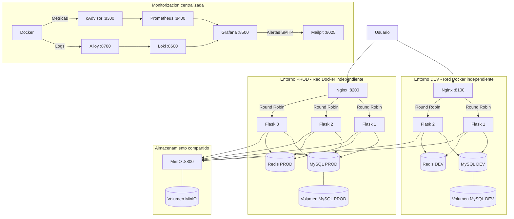

# Practica 2 - Redes Avanzadas

## Infraestructura como codigo con Terraform y Docker

Despliegue automatizado de una aplicacion web de Inazuma Eleven
mediante Terraform y contenedores Docker.

El proyecto dispone de dos entornos simultaneos, DEV y PROD,
con balanceo de carga, persistencia de datos, cache, almacenamiento
compartido, monitorizacion, alertas y centralizacion de registros.

## 1. Objetivos

- Automatizar el despliegue mediante Terraform.
- Reutilizar infraestructura mediante modulos.
- Separar los entornos DEV y PROD.
- Implementar balanceo de carga Round Robin.
- Proporcionar alta disponibilidad en la capa Flask de PROD.
- Monitorizar CPU, memoria y estado de los contenedores.
- Generar alertas ante caidas de servicios.
- Centralizar los registros mediante Loki y Alloy.
- Compartir archivos mediante almacenamiento de objetos MinIO.
- Automatizar las pruebas y la demostracion mediante Makefile.

## 2. Arquitectura



## 3. Tecnologias utilizadas

| Tecnologia | Funcionalidad |
|---|---|
| Terraform | Infraestructura como codigo |
| Docker | Ejecucion de contenedores |
| Flask | Aplicacion web |
| MySQL | Base de datos relacional |
| Redis | Cache |
| Nginx | Balanceador de carga |
| cAdvisor | Metricas de contenedores |
| Prometheus | Recopilacion de metricas |
| Grafana | Visualizacion y alertas |
| Loki | Almacenamiento de registros |
| Alloy | Recopilacion de registros |
| Mailpit | Recepcion local de correos |
| MinIO | Almacenamiento de objetos compatible con S3 |
| Makefile | Automatizacion |
| Git y GitHub | Control de versiones |

## 4. Entornos

| Caracteristica | DEV | PROD |
|---|---|---|
| Replicas Flask | 2 | 3 |
| Balanceador | Nginx | Nginx |
| Politica | Round Robin | Round Robin |
| Base de datos | MySQL | MySQL |
| Cache | Redis | Redis |
| Puerto web | 8100 | 8200 |
| Red Docker | Independiente | Independiente |
| Monitorizacion | Si | Si |
| Alertas | Si | Si |
| Almacenamiento MinIO | Compartido | Compartido |

Las replicas web son intercambiables y muestran su identificador
de instancia.

Cada entorno dispone de su propia base de datos, cache y red Docker.
MinIO se conecta a ambas redes para proporcionar almacenamiento
compartido.

## 5. Estructura del proyecto

```text
Practica2/
├── app/
│   └── Aplicacion web Flask
├── environments/
│   ├── dev/
│   │   └── terraform.tfvars
│   ├── prod/
│   │   └── terraform.tfvars
│   └── monitoring/
│       └── grafana/
├── modules/
│   └── Modulos reutilizables Terraform
├── scripts/
│   ├── init-minio.sh
│   ├── export-grafana.py
│   ├── restore-grafana.py
│   ├── test-cache.sh
│   ├── test-persistencia.sh
│   ├── test-minio.sh
│   ├── test-monitoring.sh
│   ├── test-logs.sh
│   ├── demo-alertas.sh
│   └── demo.sh
├── Makefile
├── .gitignore
└── README.md
```

La infraestructura se organiza mediante modulos reutilizables,
variables de entrada y salidas de Terraform.

Los archivos terraform.tfvars permiten configurar independientemente
el numero de replicas y el nombre de cada entorno.

## 6. Requisitos

- Ubuntu o entorno Linux compatible.
- Docker Engine.
- Terraform.
- GNU Make.
- Git.
- Python 3.
- curl.
- Conexion a Internet para descargar las imagenes y proveedores.

El usuario debe disponer de permisos para utilizar Docker.

## 7. Instalacion y despliegue

### Clonar el repositorio

```bash
git clone https://github.com/Jecris910/Practica2-RedesAvanzadas.git
cd Practica2-RedesAvanzadas
```

### Consultar los comandos disponibles

```bash
make help
```

### Desplegar la infraestructura

```bash
make deploy-full
```

Este comando inicializa Terraform, valida la configuracion,
despliega DEV, PROD y la plataforma de monitorizacion,
inicializa MinIO y realiza comprobaciones de funcionamiento.

### Recuperar la configuracion de Grafana

```bash
make restore-grafana
```

El script solicita las credenciales de Grafana de forma interactiva.

Permite recuperar las fuentes de datos, carpetas, dashboards,
contactos, alertas y politicas de notificacion exportadas.

La restauracion sobre la instancia existente se ha comprobado
sin duplicar recursos.

### Comprobar el despliegue

```bash
make check-full
make status
make test-monitoring
```

## 8. Acceso a los servicios

Las siguientes direcciones corresponden a la maquina donde
se ejecuta Docker.

| Servicio | URL |
|---|---|
| Aplicacion DEV | http://localhost:8100 |
| Aplicacion PROD | http://localhost:8200 |
| cAdvisor | http://localhost:8300 |
| Prometheus | http://localhost:8400 |
| Grafana | http://localhost:8500 |
| Loki | http://localhost:8600 |
| Alloy | http://localhost:8700 |
| Mailpit | http://localhost:8025 |
| MinIO API | http://localhost:8800 |
| MinIO Consola | http://localhost:8801 |

## 9. Balanceo de carga

Nginx distribuye las peticiones entre las replicas Flask
mediante la politica Round Robin.

Esta politica reparte las solicitudes sucesivamente entre
las instancias disponibles, sin asignar prioridades diferentes.

DEV dispone de dos replicas y PROD dispone de tres replicas.

```bash
make balance-dev
make balance-prod
```

Resultados observados:

| Entorno | Peticiones | Distribucion |
|---|---:|---|
| DEV | 10 | 5 + 5 |
| PROD | 12 | 4 + 4 + 4 |

Se ha comprobado que Nginx puede seguir atendiendo peticiones
cuando una replica Flask de PROD se detiene.

## 10. Persistencia y cache

MySQL utiliza volumenes Docker persistentes e independientes
para cada entorno.

Redis almacena temporalmente los resultados de las consultas
de equipos, evitando consultas repetidas a MySQL.

```bash
make test-cache
make test-persistencia
```

### Resultados reales de la prueba Redis

| Entorno | CACHE MISS | CACHE HIT |
|---|---:|---:|
| DEV | 189.87 ms | 17.51 ms |
| PROD | 103.61 ms | 10.72 ms |

En ambos entornos se recuperaron 17 equipos.

Estos tiempos corresponden a una ejecucion concreta de la prueba.
Pueden variar dependiendo de la carga y los recursos disponibles.

### Resultados de persistencia

Se compararon los datos de los jugadores mediante SHA256
antes y despues de reiniciar MySQL.

| Entorno | Resultado |
|---|---|
| DEV | Hash inicial y final identicos |
| PROD | Hash inicial y final identicos |

La prueba verifica la conservacion de los datos tras un reinicio.
La recreacion completa del contenedor requiere una prueba adicional.

## 11. Almacenamiento compartido

MinIO proporciona almacenamiento de objetos compatible con S3.

La aplicacion consume el archivo prueba.txt desde el bucket
practica2-static.

El objeto se puede consultar desde la propia aplicacion mediante:

```text
/storage/prueba.txt
```

Inicializacion y comprobacion:

```bash
make init-minio
make test-minio
```

Resultado obtenido:

| Replica | HTTP | Archivo |
|---|---:|---|
| DEV Flask 1 | 200 | Identico |
| DEV Flask 2 | 200 | Identico |
| PROD Flask 1 | 200 | Identico |
| PROD Flask 2 | 200 | Identico |
| PROD Flask 3 | 200 | Identico |

Las cinco replicas obtuvieron el mismo contenido,
verificado mediante SHA256.

## 12. Monitorizacion

cAdvisor recopila metricas de los contenedores Docker.

Prometheus almacena las metricas y Grafana permite consultarlas
mediante dashboards.

Se dispone de visualizaciones de:

- Utilizacion de CPU.
- Consumo de memoria RAM.
- Estado de los contenedores.
- Monitorizacion conjunta de DEV y PROD.

```bash
make test-monitoring
```

Resultados obtenidos:

- Siete servicios de monitorizacion y almacenamiento accesibles.
- Dos targets de Prometheus activos.
- Metricas de CPU, memoria y ultima deteccion disponibles.

## 13. Alertas

Grafana dispone de cinco reglas de alertas:

| Alerta | Condicion |
|---|---|
| Flask DEV | Menos de dos replicas detectadas |
| Flask PROD | Menos de tres replicas detectadas |
| Nginx PROD | Ausencia de metricas recientes |
| MySQL PROD | Ausencia de metricas recientes |
| Redis PROD | Ausencia de metricas recientes |

Las alertas utilizan la ultima deteccion de los contenedores.
No sustituyen una comprobacion completa de salud de la aplicacion.

Las notificaciones se envian mediante SMTP a Mailpit,
sin utilizar cuentas de correo personales.

Las alertas de replicas Flask DEV y PROD se han probado
mediante caidas controladas.

### Pruebas disponibles

```bash
make alert-flask-dev
make alert-flask-prod
make alert-nginx
make alert-mysql
make alert-redis
```

Los scripts detienen temporalmente el servicio seleccionado
y posteriormente lo recuperan.

Realizar las pruebas individualmente.

## 14. Centralizacion de registros

Grafana Alloy recoge los registros de los contenedores Docker
y los envia a Loki.

Grafana Explore permite consultar los registros mediante LogQL.

Consulta general:

```logql
{container=~"practica2-(dev|prod)-.*"}
```

Consulta del balanceador PROD:

```logql
{container="practica2-prod-nginx"}
```

Prueba automatica:

```bash
make test-logs
```

Resultado obtenido:

| Entorno | Peticiones | Registros recuperados |
|---|---:|---:|
| DEV | 5 | 5 |
| PROD | 5 | 5 |

Cada prueba genera un identificador unico para comprobar
que los registros consultados corresponden al trafico generado.

## 15. Comandos principales

| Comando | Funcionalidad |
|---|---|
| make help | Mostrar ayuda |
| make deploy-full | Desplegar infraestructura |
| make validate-all | Validar DEV y PROD |
| make validate-monitoring | Validar monitorizacion |
| make check-full | Comprobar servicios principales |
| make status | Mostrar contenedores |
| make balance-dev | Comprobar balanceo DEV |
| make balance-prod | Comprobar balanceo PROD |
| make test-cache | Comprobar Redis |
| make test-persistencia | Comprobar MySQL |
| make test-minio | Comprobar almacenamiento |
| make test-monitoring | Comprobar metricas |
| make test-logs | Comprobar registros |
| make export-grafana | Exportar configuracion |
| make restore-grafana | Restaurar configuracion |
| make demo | Demostracion interactiva |

## 16. Demostracion

```bash
make demo
```

La demostracion consta de 16 apartados interactivos:

1. Arquitectura.
2. Infraestructura como codigo.
3. Contenedores desplegados.
4. Funcionamiento simultaneo DEV y PROD.
5. Balanceo DEV.
6. Balanceo PROD.
7. Cache Redis.
8. Persistencia MySQL.
9. Almacenamiento MinIO.
10. Monitorizacion.
11. CPU.
12. Memoria RAM.
13. Estado de los contenedores.
14. Registros centralizados.
15. Alta disponibilidad y alertas.
16. Recuperacion y comprobacion final.

La demostracion incluye reinicios y paradas controladas.
Debe realizarse en el entorno de practicas.

## 17. Seguridad y limitaciones

- Los archivos de estado Terraform se excluyen del repositorio.
- Los archivos tfvars versionados contienen configuracion publica.
- Las credenciales de Grafana se solicitan interactivamente.
- MinIO utiliza una contrasena generada por Terraform.
- Las notificaciones utilizan un servidor SMTP local.
- Los entornos disponen de redes Docker independientes.
- MinIO es un servicio compartido entre ambos entornos.

La alta disponibilidad se aplica a las replicas Flask.
Nginx, MySQL, Redis y MinIO no disponen de replicacion
de alta disponibilidad en esta implementacion.

La infraestructura esta orientada a un entorno academico,
no a un despliegue de produccion real.

## 18. Control de versiones

El desarrollo se ha realizado mediante commits incrementales
organizados por funcionalidades.

El repositorio conserva la evolucion de la infraestructura,
la aplicacion, la monitorizacion, el almacenamiento
y las pruebas automaticas.

## 19. Uso de inteligencia artificial

Se ha utilizado ChatGPT como herramienta de apoyo para el
desarrollo, la resolucion de errores, la configuracion
de infraestructura, la automatizacion y la documentacion.

Las configuraciones y pruebas se han ejecutado en Ubuntu
para verificar su funcionamiento.

