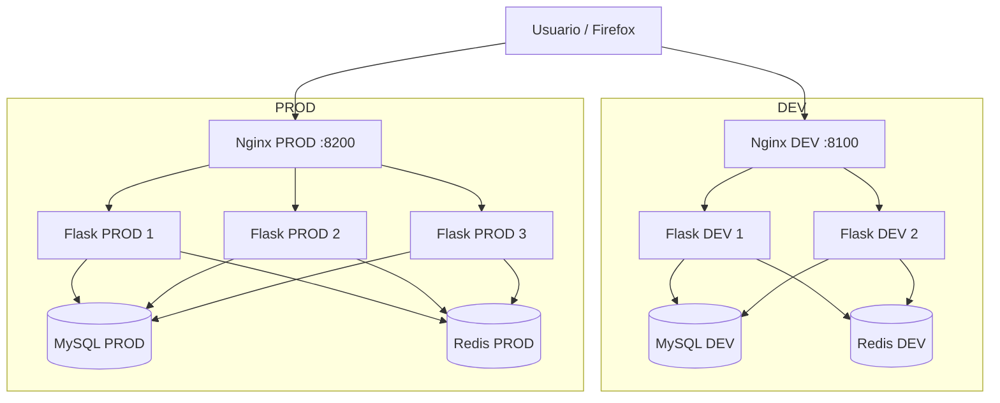

# Práctica 2 - Redes Avanzadas

## Infraestructura como Código con Terraform y Docker

Despliegue de la aplicación **Inazuma Eleven**, desarrollada en la Práctica 1, mediante infraestructura como código utilizando Terraform y el proveedor Docker.

La infraestructura dispone de dos entornos independientes, DEV y PROD, con aplicaciones Flask replicadas, bases de datos MySQL, caché Redis y balanceadores de carga Nginx.

## 1. Objetivos

- Automatizar la creación de infraestructura con Terraform.
- Separar desarrollo y producción mediante redes Docker.
- Reutilizar módulos comunes entre entornos.
- Configurar persistencia de datos en MySQL.
- Implementar una caché Redis.
- Distribuir peticiones mediante Nginx y Round Robin.
- Mostrar en la interfaz la instancia Flask que atiende cada página.
- Demostrar tolerancia a la caída de una réplica web.
- Incorporar monitorización, logs, alertas y almacenamiento compartido.

## 2. Tecnologías

| Tecnología | Función |
|---|---|
| Terraform | Infraestructura como código |
| Docker | Contenedores y redes |
| Python y Flask | Aplicación web |
| MySQL 8.4 | Base de datos |
| Redis 7.4 | Caché |
| Nginx 1.29 | Balanceador de carga |
| GNU Make | Automatización |

Las tecnologías de monitorización y almacenamiento se documentarán cuando se implementen.

## 3. Arquitectura



DEV y PROD tienen redes y volúmenes de base de datos independientes. Ambos entornos pueden funcionar simultáneamente.

### Entorno DEV

- 1 Nginx, puerto 8100.
- 2 instancias Flask.
- 1 MySQL con volumen persistente.
- 1 Redis.
- Red `practica2-dev-network`.

### Entorno PROD

- 1 Nginx, puerto 8200.
- 3 instancias Flask.
- 1 MySQL con volumen persistente.
- 1 Redis.
- Red `practica2-prod-network`.

## 4. Organización del proyecto

```text
Practica2/
├── app/                   # Flask, HTML e imágenes
├── db/                    # Dockerfile e inicialización MySQL
├── modules/
│   ├── network/           # Redes Docker
│   ├── database/          # MySQL y persistencia
│   ├── cache/             # Redis
│   ├── web/               # Réplicas Flask
│   └── loadbalancer/      # Nginx y Round Robin
├── environments/
│   ├── dev/               # Terraform para desarrollo
│   └── prod/              # Terraform para producción
├── Makefile               # Comandos automatizados
├── .gitignore             # Exclusión de archivos sensibles
└── README.md
```

## 5. Requisitos de instalación

Se necesita:

- Un sistema Linux con Docker instalado y activo.
- Terraform y acceso al proveedor Docker.
- GNU Make.
- Python 3 para las pruebas automatizadas.
- Git para clonar el repositorio.

Las imágenes de los servicios se obtienen o construyen mediante Docker.

## 6. Instalación y despliegue

Clonar el repositorio:

```bash
git clone https://github.com/Jecris910/Practica2-RedesAvanzadas.git
cd Practica2-RedesAvanzadas
```

Inicializar Terraform:

```bash
make init-dev
make init-prod
```

Validar las configuraciones:

```bash
make fmt
make validate-dev
make validate-prod
```

Comprobar los cambios:

```bash
make plan-dev
make plan-prod
```

Desplegar ambos entornos:

```bash
make up-dev
make up-prod
```

También puede utilizarse:

```bash
make up-all
```

Terraform crea los contenedores, redes y volúmenes definidos en cada entorno.

Los archivos `terraform.tfvars` se mantienen localmente y no se publican en GitHub. Las variables de entorno están definidas en `variables.tf` y sus valores locales deben configurarse antes del despliegue.

## 7. Acceso a la aplicación web

Los servicios se publican en la dirección de loopback de la máquina Ubuntu.

| Entorno | Dirección |
|---|---|
| DEV | http://localhost:8100 |
| PROD | http://localhost:8200 |

Los contenedores Flask, MySQL y Redis no publican puertos al host. Se comunican a través de sus redes Docker.

## 8. Balanceador de carga

Se utiliza Nginx con la política **Round Robin**.

Nginx distribuye las peticiones sucesivas entre las réplicas Flask disponibles.

- DEV: 2 instancias.
- PROD: 3 instancias.

La aplicación muestra un identificador diferente en cada réplica, por ejemplo `dev-flask-1` o `prod-flask-3`.

La configuración incluye reintentos ante determinados errores de conexión y mecanismos para gestionar temporalmente servidores fallidos.

## 9. Pruebas y verificaciones

### 9.1. Estado de servicios

```bash
make status
make check
```

El endpoint `/status` permite consultar el estado de Flask, MySQL y Redis.

Resultados comprobados: los servicios respondieron con `connected` en DEV y PROD.

### 9.2. Round Robin

```bash
make balance-dev
make balance-prod
```

Prueba realizada en DEV:

- 10 peticiones.
- 5 respuestas desde `dev-flask-1`.
- 5 respuestas desde `dev-flask-2`.

Prueba realizada en PROD:

- 12 peticiones.
- 4 respuestas por cada una de las tres instancias Flask.

El orden de inicio puede variar, pero el reparto fue uniforme durante las pruebas.

### 9.3. Tolerancia a fallos de una réplica

Detener una instancia web de PROD:

```bash
docker stop practica2-prod-flask-2
```

Comprobar que Nginx continúa respondiendo:

```bash
make balance-prod
```

Resultado comprobado: el balanceador siguió atendiendo peticiones utilizando `prod-flask-1` y `prod-flask-3`.

Recuperar la instancia:

```bash
docker start practica2-prod-flask-2
```

Esta prueba demuestra tolerancia a la caída de una réplica Flask, pero no alta disponibilidad del balanceador Nginx.

### 9.4. Persistencia MySQL

La base de datos utiliza un volumen Docker persistente.

Se introdujo un registro de prueba en PROD y se recreó el contenedor MySQL, comprobando que el registro permanecía almacenado.

### 9.5. Caché Redis

Se comprobó el funcionamiento de la caché observando respuestas MISS y HIT.

Las respuestas HIT recuperan los datos temporalmente almacenados en Redis, evitando repetir la consulta correspondiente a MySQL.

### 9.6. Validación Terraform

```bash
make validate-dev
make validate-prod
make plan-dev
make plan-prod
```

Tras desplegar los puntos 1 y 2, ambos entornos devolvieron:

```text
No changes. Your infrastructure matches the configuration.
```

### 9.7. Demostración automatizada

```bash
make demo
```

Este comando comprueba el estado de los servicios y realiza las pruebas de balanceo sin detener contenedores.

## 10. Seguridad

- MySQL y Redis funcionan dentro de redes Docker internas.
- Flask no publica puertos individuales al host.
- Solo Nginx publica los puertos HTTP de DEV y PROD.
- Las credenciales de MySQL se generan mediante el proveedor Random de Terraform.
- Las contraseñas se transmiten a los contenedores mediante variables de entorno.
- `.gitignore` excluye estados Terraform, archivos de variables locales y secretos.
- Los volúmenes MySQL utilizan protección contra eliminación accidental.

**Advertencia:** los estados locales de Terraform pueden contener valores sensibles. No deben publicarse.

## 11. Automatización

El Makefile permite inicializar, validar, planificar, desplegar y comprobar ambos entornos.

Para consultar los comandos disponibles:

```bash
make help
```

Los objetivos `down-dev` y `down-prod` invocan Terraform Destroy, pero los volúmenes MySQL tienen `prevent_destroy`. Por tanto, no debe utilizarse la destrucción completa sin planificar antes cómo preservar los datos.

## 12. Estado del proyecto

### Implementado y comprobado

- [x] Terraform con Docker.
- [x] Redes separadas DEV y PROD.
- [x] Aplicación Flask replicada.
- [x] MySQL con persistencia.
- [x] Caché Redis.
- [x] Healthchecks y endpoint `/status`.
- [x] Nginx con Round Robin.
- [x] Prueba de reparto de peticiones.
- [x] Tolerancia a la caída de una réplica PROD.
- [x] Puertos individuales Flask no publicados.
- [x] Makefile con pruebas automatizadas.

### Pendiente

- [ ] Monitorización de contenedores, CPU y memoria.
- [ ] Centralización y consulta de logs.
- [ ] Alertas activables en PROD.
- [ ] Almacenamiento de archivos compartido.
- [ ] Pruebas finales integradas.
- [ ] Preparación del ZIP y documentación final.

## 13. Uso de inteligencia artificial

Durante el desarrollo se ha utilizado ChatGPT (OpenAI, GPT-6) como herramienta de apoyo para:

- Analizar y desglosar los requisitos de las prácticas.
- Proponer y revisar configuraciones Terraform y Docker.
- Estructurar módulos reutilizables.
- Preparar comandos de comprobación y pruebas.
- Identificar y corregir errores encontrados durante el despliegue.
- Mejorar la documentación técnica.

Las configuraciones se han ejecutado y verificado en el entorno de prácticas. Esta declaración deberá revisarse y completarse antes de la entrega final.

## 14. Documentación de referencia

- Enunciado de la Práctica 1.
- Enunciado de la Práctica 2 - Infrastructure as Code.
- Documentación oficial de Terraform.
- Documentación del proveedor Docker para Terraform.
- Documentación oficial de Docker, Nginx, MySQL y Redis.
- Material de la asignatura Redes Avanzadas.

## 15. Entrega

El proyecto se aloja en un repositorio público de GitHub con commits progresivos.

La entrega final incluye el código, el README actualizado y un archivo comprimido para el campus digital.

**Fecha de entrega: 29 de noviembre de 2026.**
